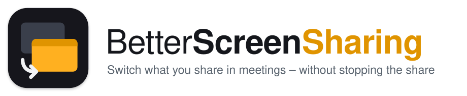

<p align="center">
  <picture>
    <source media="(prefers-color-scheme: dark)" srcset="docs/logo-dark.svg">
    
  </picture>
</p>

Switch what you share in Teams (or Zoom, Meet, Slack …) with keyboard shortcuts – without stopping and restarting the share.

https://github.com/user-attachments/assets/9c7519e4-4283-4a5b-9bf3-e2c5802b9898

**[⬇ Download BetterScreenSharing for macOS](https://github.com/Gorian90/BetterScreenSharing/releases/latest/download/BetterScreenSharing.zip)** · macOS 14 or later · Apple Silicon and Intel · free

## Install

1. Download [BetterScreenSharing.zip](https://github.com/Gorian90/BetterScreenSharing/releases/latest/download/BetterScreenSharing.zip) and unzip it.
2. Move `BetterScreenSharing.app` to Applications (or anywhere you like – it's a single file, see [Portable](#portable)).
3. Open it. The app isn't signed or notarized by Apple (that requires a paid developer account), so macOS blocks it the first time:
   - **macOS 15 Sequoia and later:** macOS says it can't verify the app. Click **Done**, open **System Settings › Privacy & Security**, scroll down and click **Open Anyway** next to BetterScreenSharing, then confirm.
   - **macOS 14 Sonoma:** right-click the app › **Open**, then **Open** again.

   You only have to do this once. Alternatively, run `xattr -dr com.apple.quarantine /Applications/BetterScreenSharing.app` in Terminal.
4. A short silent intro video shows how it works, and a guide then walks you through the permissions (see [Permissions](#permissions)).

## How it works

The app creates a **virtual display**, an extra display that exists only in software and isn't visible anywhere physically. The stage fills that display completely, including its menu bar. In the meeting app you share that display once. With keyboard shortcuts you then decide what the stage shows: any window or an entire screen, with your webcam on top and optional dimming or spotlight.

So you don't need to keep any window open. A small floating **preview** shows exactly what the audience sees. The preview itself never appears in the share, and in it you can drag the camera bubble, draw highlights and scroll to change the camera size.

The meeting app doesn't notice anything. It shares the same display the whole time, with no integration, API or plug-in, and everything runs locally.

**Virtual display or window?** The virtual display uses macOS's built-in but undocumented `CGVirtualDisplay`. It's the same technology tools like DeskPad and BetterDisplay use. No driver or installation is needed, and the display disappears when the app quits. If a future macOS version drops support, the app automatically switches to **window mode**. The stage is then shown in an ordinary window, "BetterScreenSharing – Stage", which you share instead. The window may sit behind other windows but must not be minimized. You can also choose the mode yourself in the control panel.

**Why not a virtual camera?** A virtual camera on macOS requires a signed system extension (Camera Extension), Xcode and an Apple Developer account. It also shows up in Teams as a *camera* rather than a screen share, which gives worse picture quality since the image is compressed as low-resolution video.

## Permissions

On first launch a guide goes through the permissions one at a time, with a sentence on why each is needed and a button that opens the right place in System Settings: **Screen & System Audio Recording** (required), **Accessibility** (to move windows off the virtual display) and **Camera**. If the app is missing from the list, the first time or after it was removed, macOS shows its own prompt instead and adds the app; choose to open System Settings there. Once you've turned on Accessibility or Camera, the guide moves on by itself. Screen recording only takes effect after the app restarts, so click **Restart** in the guide afterwards, and the guide continues when the app is back. If you skip Accessibility or Camera, the app won't ask again at launch, only when you use the feature. Screen recording is requested at every launch until it's on.

## Using it in the meeting app

It works the same in every meeting app; Teams is used as the example below.

1. Start BetterScreenSharing. The virtual display is created automatically and the stage is placed there.
2. Share the extra display **"BetterScreenSharing Stage"** in the meeting app. In Teams: **Share › Screen**. In Zoom: **Share Screen**. Turn on computer sound sharing if you want to share audio (in Teams: *Include computer sound*).
3. Switch content with the shortcuts below and follow the result in the preview.

The stage covers the whole invisible display, including its menu bar, so only the stage is visible. It doesn't clutter your real displays.

**Screen or window?** Under **General › In the meeting app you share** you choose how you share; the setting applies to all meeting apps. The default is *Entire screen*. If you'd rather share the window "BetterScreenSharing – Stage" (in Teams: Share › Window), choose *A window*: the stage then sits below the display's menu bar as an ordinary window. Some meeting apps, Teams among them, capture even a shared window as a cut-out of the screen, so whatever is on top of the window comes along. The setting must therefore match how you share, or the menu bar may show. If it stutters: choose 1280 × 720 as the resolution. Teams sends more frames per second when the content is smaller. In Teams you can see what's actually being sent under *More › Settings › Call health* › Screen sharing › Frame rate.

The virtual display is placed so that it only touches your real displays at one corner, top right. The mouse pointer can't go there either: if it lands on the display it's put straight back at the edge of the nearest real display. This needs no permission.

macOS can still put windows there, for example when an app restores a saved position. There they can't be seen or reached, and they may show up in the share.

So the app moves such windows to the display where the pointer is, within about half a second. This requires the **Accessibility** permission, which you grant with **Allow Accessibility** under **General › Share in the meeting app**. You can also turn the feature off there with **Move windows off the stage display**. Without the permission, the number of windows on the display is shown instead, and you can gather them by temporarily switching to *A separate window*.

## Keyboard shortcuts

Only two global shortcuts are preset, since shortcuts with ⌥ or ⌘ otherwise collide with too much in the system and other apps:

| Shortcut | Action |
|---|---|
| ⌥§ | Share the window you're in right now. Press again in the same window to stop sharing; in another window, sharing moves there |
| ⌥X | Stop sharing |

§ is the key below Esc (on US keyboards it's the ` key).

On first launch a guide shows the two shortcuts and lets you try them (nothing is shared while the guide is open). The guide is also under **Shortcuts › Try the shortcuts…**.

By default Caps Lock turns the spotlight on and off (see below). If you instead choose **Function mode** under **Caps Lock controls**, most other things are handled with single keys while Caps Lock is on:

| Keys | Action |
|---|---|
| Caps Lock + 1–9 | Show slot 1–9 |
| Caps Lock + § | Share the window you're in right now (or stop, if it's already shared) |
| Caps Lock + F | Share the entire screen (the one the pointer is on) |
| Caps Lock + S | Stop sharing |
| Caps Lock + Space | Spotlight that follows the mouse pointer |
| Caps Lock + B | "Just me" – the camera large in the middle |
| Caps Lock + T | Text on the stage: show/hide |
| Caps Lock + Esc | Clear the stage (highlight, spotlight, countdown, text) |

All shortcuts can be changed under **Shortcuts** in the control panel: click the shortcut and press the new combination. It must include ⌃, ⌥ or ⌘ (F keys work on their own). Esc cancels, ⌫ removes the shortcut. If you choose a combination that's already in use, it's moved, and the other action is left without a shortcut. *Reset default shortcuts* brings back the list above and *Clear all* removes every shortcut.

**Function mode with Caps Lock**: with Caps Lock on, 1–9 switch to the slots and the other actions use the default keys in the table. If you change a shortcut, its key is used without ⌃, ⌥ and ⌘ instead, and a removed shortcut has no key (1–9 always show the slots). With Caps Lock off the keys type as usual, and in the app's own text fields they always type. **Keys in function mode** shows which key does what.

With *Click and drag draws a highlight while Caps Lock is on* (on by default), click and drag draws a highlight as long as Caps Lock is on in function mode; each new box replaces the previous one. A thin yellow frame around the screen shows that drawing mode is on. Meanwhile you can't click in other apps, but the quick panel works.

Caps Lock can also control the spotlight (default), the camera, Just me or freezing the picture (choose under **Caps Lock controls**). Caps Lock on then turns the feature on and off turns it off, so the light on the key shows the state. This needs no extra permission. Caps Lock still gives capital letters when you type.

If you put *Clear the stage* on Esc, Esc is only captured when there's something to clear; the rest of the time Esc works as usual in other apps.

Note: global shortcuts apply in all apps and take precedence over the apps' own. If you've turned on ⌃1–9 to switch desktops (System Settings › Keyboard › Keyboard Shortcuts › Mission Control) they collide with your own shortcuts there. ⌥ plus a digit or letter types characters on many keyboard layouts, and ⌘1–9 switches tabs in browsers, so keep that in mind if you put your own shortcuts there.

Slots are saved between runs (re-matched by app + window title).

## Control panel

The sidebar has the sections General, Camera, Highlight and dim, Countdown, Messages, Quick panel and Shortcuts. **General** shows how the stage is shared in the meeting app, language, picture, sound and export/import of settings. **Quick panel** shows the slots as cards, where you add, arrange and remove them. The sharing itself is controlled with shortcuts or the quick panel. The content follows the window size.

The intro video can be watched again with **Watch how it works…** in the control panel.

## Language

The app is available in English (default) and Swedish. The language is chosen under **General › Language · Språk** and switches immediately, including menus and the quick panel. Default texts you haven't changed (for example the message when nothing is shared and the countdown heading) are translated at the same time; your own texts are left alone. The virtual display is called "BetterScreenSharing Stage" or "BetterScreenSharing Scen" and gets the new name the next time it's created.

## Preview in the control panel

The sections that change what the audience sees (General, Camera, Highlight and dim, Countdown and Messages) have a preview at the top. It uses the same stage view that's shared, with a sample window as content, and updates immediately when you change something.

## Menu bar and Dock

The menu bar icon shows two windows, the front one yellow as in the app icon. A red dot means something is being shared right now. If you close the control panel with the red button, the app disappears from the Dock but keeps running in the menu bar. *Show control panel* in the menu bar brings back both the panel and the Dock icon.

## Quick panel

A docked panel with quick buttons (icons only): slots 1–9, entire screen, camera, Just me, spotlight, draw highlight, clear, freeze, countdown, stop sharing, preview and the control panel. Furthest out is the sharing light, which glows amber when something is shared. Hold the pointer over a button to see its name and shortcut (in parentheses) right away. Clicking an active (yellow) button turns it off: a slot or screen being shared stops being shared, a highlight is removed and a countdown is removed. Right-click a slot (1, 2, 3 …) to remove it directly, or the timer to type a custom time (MM:SS) or a clock time (HH:MM); Return starts the countdown. Active modes glow amber. The panel never shows in the share.

Choose placement under **Quick panel** in the control panel:

- **Right edge / Left edge:** a tab at the edge. Click to expand the panel and click again to collapse it. Drag the tab up or down to move it. The dot on the tab lights up when something is shared.
- **Below the notch:** the panel joins the MacBook's notch. Click the notch to expand the panel and again to collapse it. Without a notch it ends up in the middle of the top edge.
- **Around the notch** (default on first launch; the app then remembers your choice): the buttons sit left and right of the notch, at menu bar height, so the panel takes the least possible space. Click the notch to expand and collapse it.
- **Off.**

With **Always expanded (can't be collapsed)** under **Quick panel** in the control panel, the panel is always expanded.

**Customize the quick panel** (under Quick panel in the control panel) shows the panel as it looks. Drag a tool to move it; the others move aside while you drag. Drag in more from the list of available tools, and drag a tool down to the list to remove it. Dividers can be added several times. *Sharing light* can be moved or removed like the other tools; when collapsed at the notch the light is always visible. *The notch* shows where the tools are split when the panel sits around the notch. *Reset* brings back the default set.

The preview can be docked at the quick panel in all placements and then shows when the panel is expanded. At the right or left edge it becomes its own rounded box with a drag handle on top. Drag the handle (or the area around the picture) to move it: it lands at the height where you drop it, next to the panel if its middle is level with the panel, otherwise along the edge above or below the panel. The position is saved and follows when the tab is moved. By default it sits next to the panel with the top edges aligned. Below the notch the preview joins the expanded panel, beside it (right side, or left if it doesn't fit), as a quick check of what's being shared. By default it's small and as tall as the menu, so the bottom edges line up (the picture then also uses the space up to the screen edge); the arrow button switches to a larger picture and back. **Detach** turns it into its own window that can be moved and resized; the button in the window's title bar docks it again. It can also be turned off under **Quick panel** in the control panel.

## Text on the stage

A box of text across the whole stage, in the same style as the message when nothing is shared. Below the notch the speech bubble turns on text mode, and a text field then appears in the quick panel (otherwise the row is hidden to save space). Type the text and click **Show**: the stage changes and the button turns yellow. Click again to remove the text. Closing text mode also removes the text. At the edge the speech bubble opens a box to type in. In function mode Caps Lock + T shows and hides the text. If you change the text while it's shown, the stage updates immediately. The camera shows on top. Sharing something, *Stop sharing* or *Clear the stage* removes the text. The text is also under **Messages** in the control panel, with a preview.

## Countdown

A timer for breaks and the like. Under **Countdown** in the control panel you choose:

- a length (5, 10 or 15 minutes, or custom), or a clock time to count down to according to the computer's clock and time zone (a time that has passed means tomorrow),
- when counting down to a clock time: whether the time should be written below the clock, with your own text before it (e.g. "We'll continue at 13:00") and your own color,
- a heading above the clock and an optional subheading,
- your own colors for heading, subheading, clock (and progress bar) and background,
- whether it's shown across the whole stage or small in the corner while you keep sharing,
- what happens at 00:00: a welcome message, back to what was shared, or stay at 00:00,
- a chime (about three seconds) when one minute remains. It plays on the computer, so if you share computer sound in the meeting app it's heard in the meeting too.

The control panel shows a preview of exactly what the audience will see, both during the countdown and at 00:00.

Start and pause with the quick panel, the menu bar or the control panel (or a shortcut of your own). Right-click the timer in the quick panel to type a custom time (MM:SS) or a clock time (HH:MM) directly (or pick a length in the menu bar). *Clear the stage* removes the countdown. The camera shows on top of the countdown.

If you choose something to share (a slot, the entire screen or the active window) while the countdown covers the whole stage, it's removed so the shared content shows. That also applies to the end message. A countdown in the corner keeps going.

## Camera

Shapes: circle/oval, rounded corners, bevelled corners, sharp corners, hexagon. Aspect 1:1, 4:3, 16:9 or 3:4. Size, zoom (crop), mirroring, border and shadow are set in the control panel. The bubble can be dragged directly in the stage window, and scrolling over it changes the size. "Just me" has its own size and position: while it's active, Size, Position, dragging and scrolling control the large bubble, and the border scales along.

## Highlight and dim

- **Rectangle:** *Draw highlight* (quick panel, menu bar or your own shortcut) and drag around the area on screen, or drag directly in the stage window. A click in the stage removes the highlight.
- **Spotlight:** Caps Lock (or Caps Lock + Space in function mode) – a soft circle of light follows the mouse over the shared window (or over the stage).

Dimming level, spotlight size and soft edge are set in the panel.

You see the same dimming as the audience, drawn over the shared window or screen (**Show the dimming on my screen too** under Highlight and dim, on by default). It doesn't show in the share, clicks go straight through it, and it follows along when you move a shared window. Other windows in front of the shared window are dimmed for you too, although the audience doesn't see them.

## Frame rate

The control panel shows how many frames per second come from the source and to the preview. The source only sends new frames when something changes, so low numbers for still content are normal. Troubleshooting: `open /Applications/BetterScreenSharing.app --args --diagnose /tmp/bss.txt` measures the stage's frame rate with an animated test box and writes the result to the file. Add `--stage-mode window` to measure window mode.

## When nothing is shared

In the control panel you choose what the stage shows when you stop sharing, and separately when the shared window disappears: your own text, an image or logo, yourself on camera (large) or the latest picture (frozen). Animated images (GIF, animated PNG or WebP) loop with the file's own timing. Large animations are scaled down to at most 1280 pixels and saved as GIF in the settings. With **Show heading and subtext on top of the image** the text is placed on the image, in one of nine positions you pick in a grid, with a dark box behind it so it's readable.

## Sound

Sound is shared by the meeting app itself, regardless of what the stage shows. Turn on computer sound sharing when you start sharing (in Teams: *Include computer sound*, in Zoom: *Share sound*).

## Portable

BetterScreenSharing is a single file, `BetterScreenSharing.app`, with no installation:

- No drivers, system extensions, installers or other files are needed. The virtual display is created by macOS itself while the app runs and disappears when it quits.
- The app is universal and runs on both Apple Silicon and Intel (macOS 14 or later).
- Copy the app wherever you like, for example to a USB stick or to Applications, and start it from there.
- Settings are created automatically in macOS's standard settings file for the app. Images you choose for "When nothing is shared" are stored there too, so they don't depend on the original file. With **Export settings…** and **Import…** in the control panel you move them to another Mac.
- On a new Mac the app needs permission for screen recording (and camera and Accessibility if you use them). Permissions are tied to the computer and can't travel with a file.
- To remove the app: delete `BetterScreenSharing.app`. To remove the settings too: `defaults delete local.betterscreensharing`.

## Limitations

- The virtual display shows in System Settings › Displays while the app runs. If you move it there, the app moves it back to the corner.
- Minimized windows can't be captured (macOS delivers no frames from them). The stage then shows the last frame.
- Windows on the stage display that are minimized or belong to a hidden app are only moved once they're shown again. An app that refuses to move its window is retried about every five seconds.
- If you've removed the app entirely from a permission list in System Settings (with the minus button) it won't come back by itself, since the system only asks once. Add it with the plus button there.
- From macOS 15 the system sometimes asks whether the app may still record the screen – this applies to all screen recording apps except Apple's own picker.

## Build from source

Requires macOS 14 or later and Xcode Command Line Tools.

```bash
./build.sh
open build/BetterScreenSharing.app
```

The app is signed with a local, self-signed identity ("BetterScreenSharing Local") in a keychain of its own in `signing/`, so macOS keeps the permissions between builds. Create it with `./signing/setup.sh`. Without it the app is signed ad hoc, and macOS asks for screen recording after every rebuild.

Developers: `.build/out/Products/Release/BetterScreenSharing --render-ui <folder>` draws the quick panel, the menu bar icon and the countdown to PNG files without showing anything. Run the unsigned binary, not the app, so the app's settings aren't touched. Remove the test settings afterwards with `defaults delete BetterScreenSharing`. `--write-tutorial-video <file.mp4> [en|sv]` exports the intro video, which is drawn in code.

## Code structure

| File | Contents |
|---|---|
| `AppController.swift` | Ties everything together: switching, slots, shortcuts, menu bar |
| `CaptureEngine.swift` | ScreenCaptureKit stream that swaps filter when switching |
| `StageView.swift` | The stage: picture, dim mask, spotlight, camera bubble, mouse interaction |
| `CameraController.swift` | AVFoundation camera |
| `VirtualDisplayManager.swift`, `VirtualDisplayShim/` | The virtual stage display |
| `WindowShepherd.swift` | Moves other apps' windows off the stage display (Accessibility) |
| `CursorFence.swift` | Keeps the mouse pointer off the stage display |
| `PermissionWizard.swift` | The guide that goes through the permissions, one at a time |
| `ShortcutGuide.swift` | The guide where you try the two default shortcuts |
| `TutorialVideo.swift` | The silent intro video, drawn in code |
| `PreviewWindow.swift` | Floating preview with mouse control |
| `HotkeyManager.swift` | Global shortcuts (Carbon – no Accessibility permission needed) |
| `Overlays.swift` | On-screen highlight, HUD, menu help |
| `ControlPanel.swift` | The control panel with sidebar (SwiftUI) |
| `QuickDock.swift` | The quick panel at the edge or the notch |
| `DockEditor.swift` | Customizing the quick panel by drag and drop |
| `TimeFields.swift` | The time fields in the timer box (two fields with a fixed colon) |
| `PresenterDim.swift` | The dimming on the presenter's own screen |
| `AnimatedImage.swift` | Animated images for "When nothing is shared" |
| `Icons.swift` | The app icon and menu bar icon, drawn in code |
| `Chime.swift` | The countdown's warning chime, synthesized in code |
| `Diagnostics.swift` | Frame rate measurement and command-line tools |
| `AppState.swift`, `Models.swift` | State and settings |
| `Localization.swift` | Language choice and `L("English", "Swedish")` for every text in the app |
